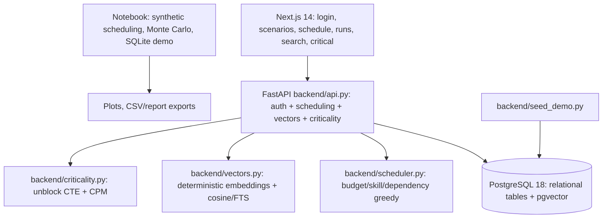

# Architecture (current: Next.js + FastAPI + PostgreSQL 18 + pgvector)

- **Next.js frontend** (`frontend/app/page.tsx`): login (admin/operator), scenario CRUD (admin-gated),
  run-and-save scheduling, saved runs + actions, vector/FTS search, critical-repairs tab.
- **FastAPI backend** (`backend/api.py`): bearer-token auth, all routes above, transactional `save_run`.
- **PostgreSQL 18 + pgvector 0.8.6**: 11 tables, view, trigger, 2 stored procedures,
  B-tree + HNSW + GIN indexes. All data synthetic.
- **Notebook** (`notebook/GridRestore_Lab.ipynb`): standalone teaching workflow on SQLite;
  simplified heuristics, not the backend scheduler.
