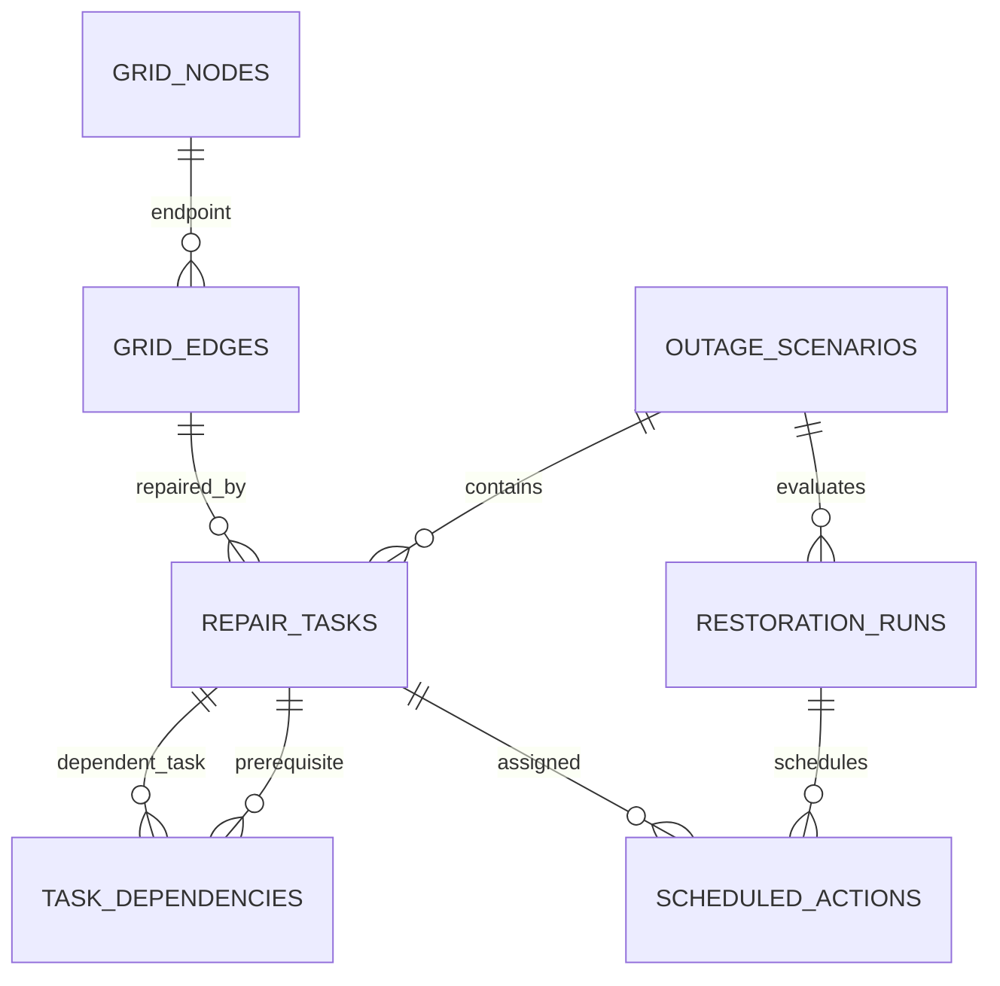
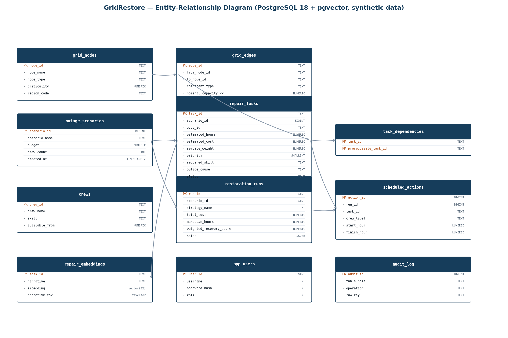

# ER diagram

## Data dictionary (PostgreSQL 18 + pgvector — all data synthetic)

## 1. grid_nodes — synthetic network nodes
| Column | Type | Key / Constraint | Meaning |
|---|---|---|---|
| node_id | TEXT | PK | Node key, e.g. S1, H1 |
| node_name | TEXT | NOT NULL | Display name |
| node_type | TEXT | NOT NULL | substation, bus, hospital, water_facility, residential, industrial |
| criticality | NUMERIC(5,2) | CHECK 0–10 | Project-defined criticality weight |
| region_code | TEXT | NOT NULL, indexed | North / Central / South |

## 2. grid_edges — synthetic connections
| Column | Type | Key / Constraint | Meaning |
|---|---|---|---|
| edge_id | TEXT | PK | Connection key, e.g. E1 |
| from_node_id | TEXT | FK → grid_nodes | Start endpoint |
| to_node_id | TEXT | FK → grid_nodes | End endpoint |
| component_type | TEXT | NOT NULL | feeder, line, tie_line |
| nominal_capacity_kw | NUMERIC(12,2) | CHECK > 0 | Synthetic capacity |
| (from,to) | — | UNIQUE | No duplicate connection |

## 3. outage_scenarios — planning scenarios
| Column | Type | Key / Constraint | Meaning |
|---|---|---|---|
| scenario_id | BIGINT | PK, identity | Scenario identifier |
| scenario_name | TEXT | CHECK non-blank | Scenario label |
| created_at | TIMESTAMPTZ | DEFAULT now() | Creation time |
| budget | NUMERIC(12,2) | CHECK > 0 | Synthetic credit budget |
| crew_count | INT | CHECK > 0 | Declared crew count |

## 4. repair_tasks — repairs to schedule
| Column | Type | Key / Constraint | Meaning |
|---|---|---|---|
| task_id | TEXT | PK | Task key, e.g. T01 |
| scenario_id | BIGINT | FK → outage_scenarios, cascade | Parent scenario |
| edge_id | TEXT | FK → grid_edges | Faulted component |
| component_name | TEXT | NOT NULL | Display label |
| estimated_hours | NUMERIC(8,2) | CHECK > 0 | Synthetic duration |
| estimated_cost | NUMERIC(12,2) | CHECK ≥ 0 | Synthetic cost |
| service_weight | NUMERIC(8,2) | CHECK ≥ 0 | Project-defined weight |
| priority | SMALLINT | CHECK 1–5 (1 = highest) | Triage priority |
| region_code | TEXT | DEFAULT 'Unassigned' | Work region |
| required_skill | TEXT | DEFAULT 'general' | general / electrical (multi-skill crews cover all) |
| outage_cause | TEXT | storm/equipment_age/vehicle_impact/vegetation/unknown, indexed | Texture for GROUP BY/HAVING demo |
| status | TEXT | pending/scheduled/completed/blocked | Workflow state |

## 5. task_dependencies — repair prerequisites (DAG)
| Column | Type | Key / Constraint | Meaning |
|---|---|---|---|
| task_id | TEXT | PK part, FK → repair_tasks | Dependent task |
| prerequisite_task_id | TEXT | PK part, FK → repair_tasks | Must finish first |
| — | — | CHECK task ≠ prerequisite | No self-loops |

## 6. crews — repair crews
| Column | Type | Key / Constraint | Meaning |
|---|---|---|---|
| crew_id | TEXT | PK | Crew key |
| crew_name | TEXT | NOT NULL | Display name |
| skill | TEXT | NOT NULL | general / electrical / multi-skill |
| available_from | NUMERIC(10,2) | CHECK ≥ 0 | Free-from hour |

## 7. restoration_runs — one strategy evaluation
| Column | Type | Key / Constraint | Meaning |
|---|---|---|---|
| run_id | BIGINT | PK, identity | Run identifier |
| scenario_id | BIGINT | FK → outage_scenarios, cascade | Parent scenario |
| strategy_name | TEXT | NOT NULL | priority_first / shortest_repair_first / gridrestore_score |
| started_at | TIMESTAMPTZ | DEFAULT now() | Run time |
| total_cost | NUMERIC(12,2) | CHECK ≥ 0 | Summed action cost |
| makespan_hours | NUMERIC(10,2) | CHECK ≥ 0 | Max crew finish |
| weighted_recovery_score | NUMERIC(12,4) | NOT NULL | Project-defined metric, not a standard |
| notes | JSONB | DEFAULT '{}' | Crew snapshot etc. |
| reviewed_by | TEXT | NULL | Added via ALTER (DDL proof) |

## 8. scheduled_actions — tasks in a run
| Column | Type | Key / Constraint | Meaning |
|---|---|---|---|
| action_id | BIGINT | PK, identity | Action identifier |
| run_id | BIGINT | FK → restoration_runs, cascade | Parent run |
| task_id | TEXT | FK → repair_tasks | Scheduled task |
| crew_label | TEXT | NOT NULL | Assigned crew |
| start_hour | NUMERIC(10,2) | CHECK ≥ 0 | Start |
| finish_hour | NUMERIC(10,2) | CHECK > start | Finish |
| (run_id, task_id) | — | UNIQUE | One slot per task per run |

## 9. repair_embeddings — vector paradigm (pgvector)
| Column | Type | Key / Constraint | Meaning |
|---|---|---|---|
| task_id | TEXT | PK, FK → repair_tasks | Linked repair |
| narrative | TEXT | CHECK non-blank | Repair description text |
| embedding | vector(32) | NOT NULL, HNSW cosine index | Deterministic hash embedding (see backend/vectors.py) |
| narrative_tsv | tsvector | generated, GIN index | Full-text companion |
| updated_at | TIMESTAMPTZ | DEFAULT now() | Last embed time |

## 10. app_users — role-based auth
| Column | Type | Key / Constraint | Meaning |
|---|---|---|---|
| user_id | BIGINT | PK, identity | User identifier |
| username | TEXT | UNIQUE, 3–50 chars | Login name |
| password_hash | TEXT | NOT NULL | bcrypt hash — never plain text |
| role | TEXT | admin / operator | admin creates, operator runs/views |
| created_at | TIMESTAMPTZ | DEFAULT now() | Creation time |

## 11. audit_log — change record
| Column | Type | Key / Constraint | Meaning |
|---|---|---|---|
| audit_id | BIGINT | PK, identity | Event identifier |
| table_name | TEXT | NOT NULL | e.g. repair_tasks |
| operation | TEXT | NOT NULL | INSERT / UPDATE / DELETE |
| row_key | TEXT | NULL | Affected task_id |
| changed_at | TIMESTAMPTZ | DEFAULT now() | Event time |
| db_user | TEXT | DEFAULT current_user | DB actor |

## Views, procedures, triggers, indexes
- VIEW `v_restoration_run_summary` — run + scenario + scheduled count.
- FUNCTION `audit_repair_task_change()` + TRIGGER `trg_repair_task_audit` — logs repair_tasks changes.
- FUNCTION `upsert_repair_embedding()` / `search_similar_repairs()` — vector write + cosine search.
- B-tree: region, (scenario,status), (scenario,strategy), (run,start). HNSW: embedding cosine. GIN: narrative_tsv.

