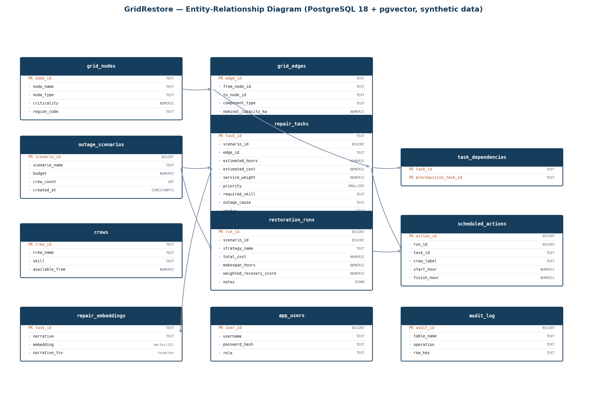
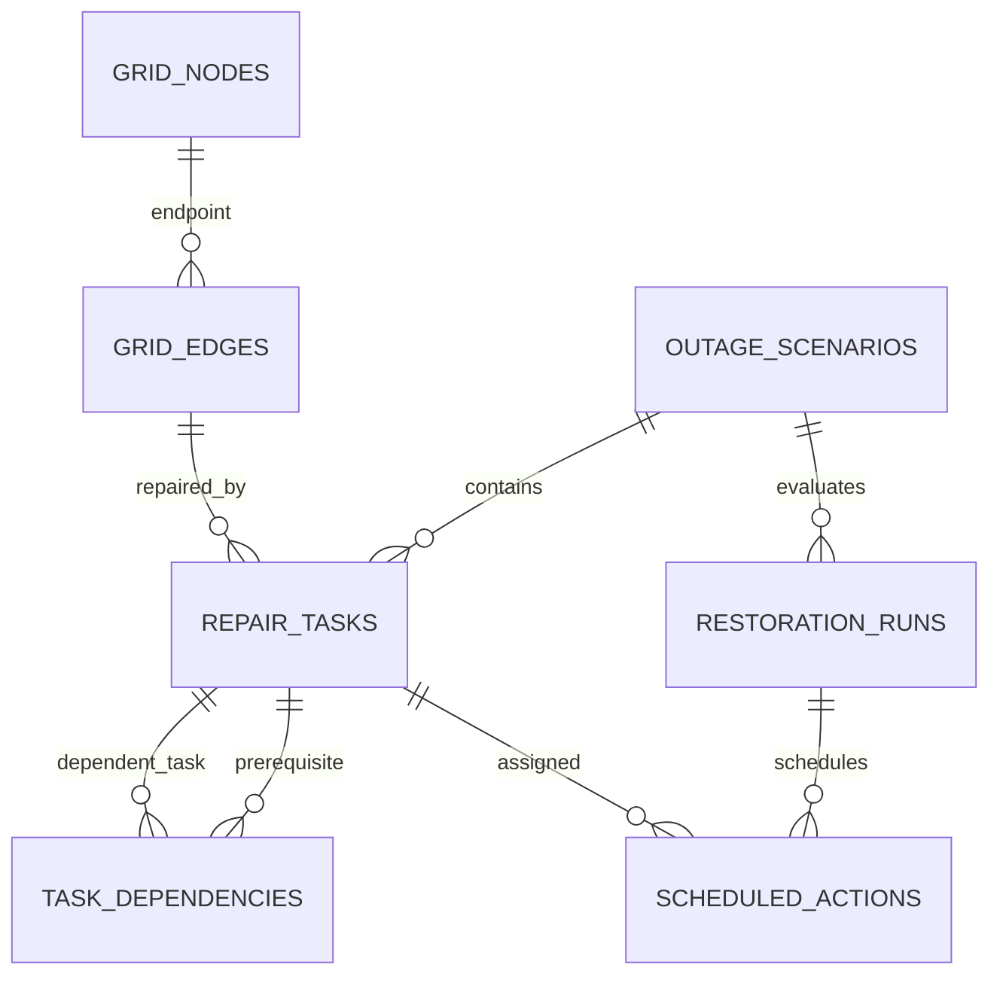
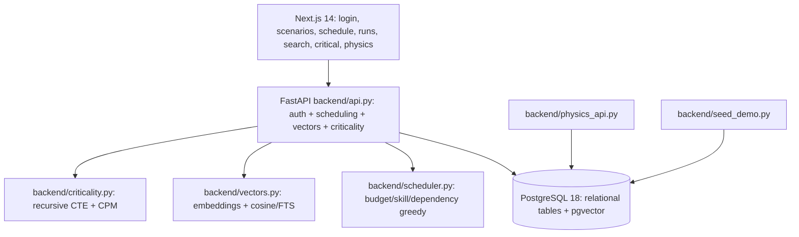
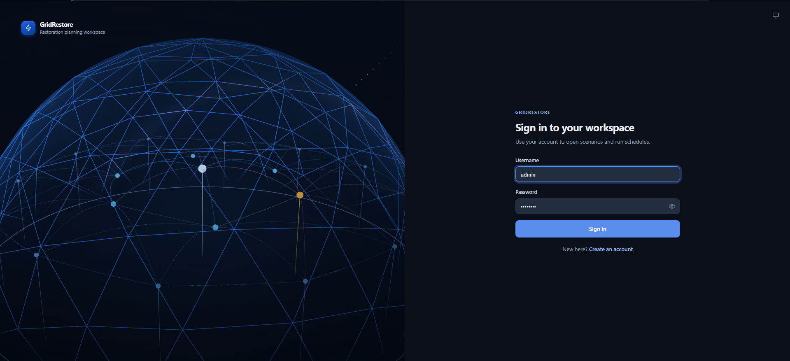
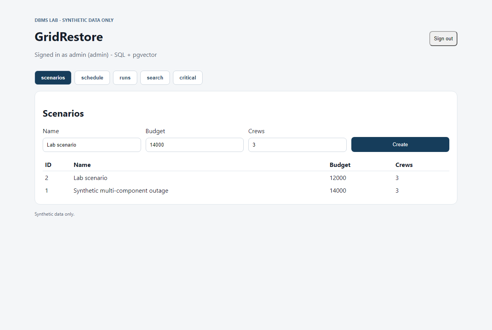
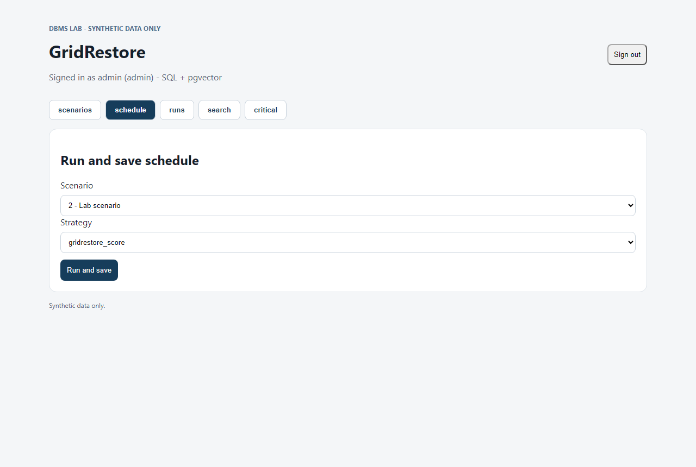
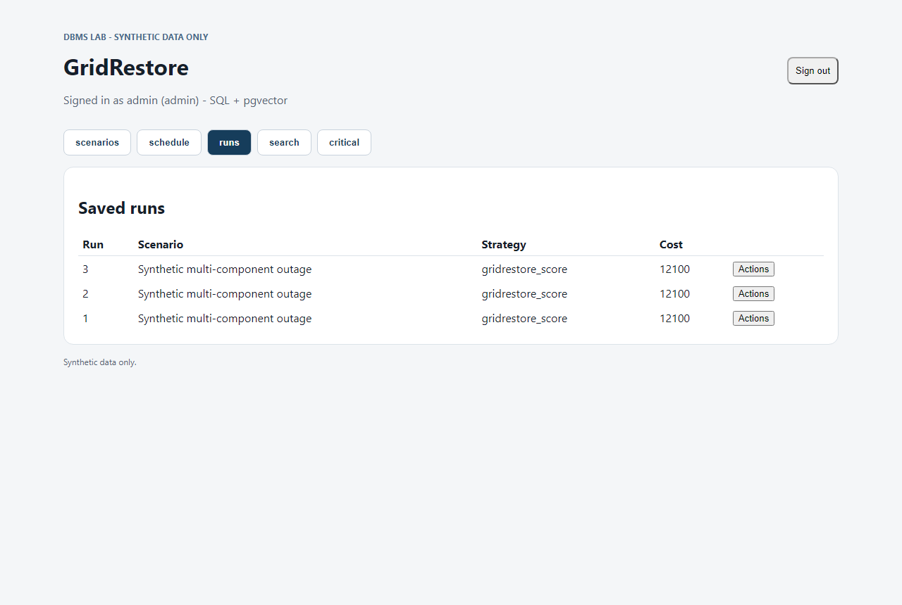
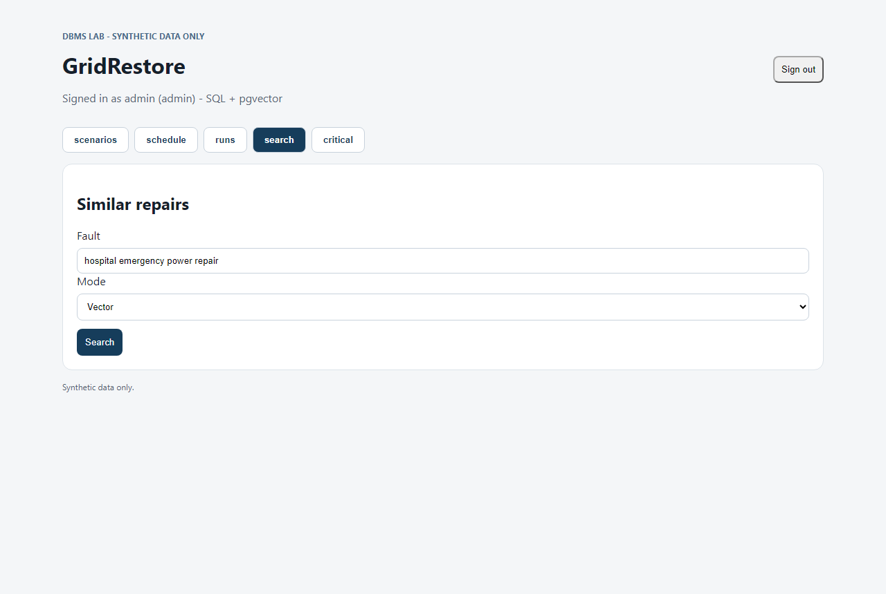

# GridRestore — Unified Project Report
(DBMS Experiential Learning — Level 3 Project. All database, scheduling and physics requirements addressed in a single document.)

---

## 1. Problem statement

After a major power-distribution outage, the utility must decide **which repairs to do first**: repair budgets are limited, crews are few and have different skills, and some repairs cannot start before others finish. Choosing badly stretches the blackout and wastes money on low-value work. A second, linked question is **how far the affected network is from its physical limits** (thermal and voltage) and whether false data injected into the state estimator can stay hidden from the bad-data test.

GridRestore answers the first question with a scheduling application backed by PostgreSQL, and the second with a physics study over standard IEEE test networks.

## 2. Objectives

1. Schedule repair tasks under budget, crew-skill and dependency constraints, comparing several heuristics against an exact mixed-integer baseline on small instances.
2. Persist scenarios, runs, versions and audit history in PostgreSQL with database-enforced integrity rules.
3. Find similar past repairs by meaning using a vector database (pgvector), complemented by full-text search.
4. Model the damaged network physically (power flow, state estimation, continuation load margins) and study stealthy false-data injection.
5. Expose everything through a REST API and a Next.js web interface with role-based access.
6. Test the whole system with an automated suite.

## 3. Scope

- **In scope:** synthetic outage scenarios, repair tasks, grid nodes/edges, crews, budgets (PostgreSQL); restoration-run scheduling, versions, audit, CSV import/export, dashboards; pgvector semantic search (+ tsvector full text); IEEE benchmark networks (case14/30/9/57/118) physics study; REST API + Next.js UI; automated tests; Docker Compose stack.
- **Out of scope:** real utility data (all data is synthetic or from published benchmarks), operational control of physical equipment, multi-step MDP load growth, the link between repair tasks and network elements (kept deliberately separate — see §14).

## 4. Functional requirements

| # | Requirement | Where implemented |
|---|---|---|
| FR1 | Login with roles admin/operator | `database/migrations/003_auth.sql`, `backend/auth.py`, login page |
| FR2 | Create/list outage scenarios (admin-gated) | `backend/api.py`, scenarios tab |
| FR3 | Build a schedule under budget/crew/dependency constraints and save it as a run | `backend/scheduler.py`, `backend/exact.py` |
| FR4 | Compare saved runs task-by-task (diffs), export Markdown reports | `backend/diffing.py`, `backend/report.py` |
| FR5 | Scenario versioning: every edit stored, compare and roll back without losing history | `backend/versions.py`, migration 005 |
| FR6 | Database-enforced rule: a crew may not be double-booked in one run | `EXCLUDE USING gist`, migration 005 |
| FR7 | Audit trail with old/new rows and the acting user (admin-only tab) | trigger, migration 005 |
| FR8 | CSV bulk import: invalid file lists every row error and imports nothing | `backend/tasks_io.py` |
| FR9 | Similar-repair semantic search (vector) with full-text companion | `backend/vectors.py`, `002_vectors.sql` |
| FR10 | Critical-repairs view: downstream unblock count + CPM critical path | `backend/criticality.py`, recursive CTE |
| FR11 | Physics read-only endpoints and Physics tab (continuation chart, FDIA, MDP) | `backend/physics_api.py`, `backend/grid/` |
| FR12 | Materialized run-statistics dashboard with staleness flag and admin-only refresh | migration 005 |

## 5. Database choice and justification

Rubric compliance: **two paradigms — SQL (mandatory) + Vector (optional-but-recommended option 2).**

- **SQL — PostgreSQL 18 (mandatory).** The grid model (nodes, edges, scenarios, tasks, dependencies, crews, runs, actions, users, audit) is naturally relational: strong PK/FK integrity, exclusion constraints, transactional multi-row writes (`save_run`). SQL also provides the DDL, DML, views, procedures, triggers and indexing the rubric requires.
- **Vector — pgvector 0.8.6 (second paradigm).** Repair *narratives* are unstructured text. SQL cannot rank "similar past fault" by meaning; embeddings can. Narratives are embedded into `repair_embeddings.embedding vector(32)` with an **HNSW cosine** index (`<=>`); a `tsvector` GIN companion column provides exact-keyword full-text search in the same query pack.
- Justified by data nature, not technology demonstration — vectors exist only where unstructured text requires them, everything else stays relational.

## 6. ER diagram and relational schema





**Tables, primary keys, foreign keys, constraints** (full per-column data dictionary in `docs/ERD.md`):

| Table | PK | FKs / key constraints | Purpose |
|---|---|---|---|
| grid_nodes | node_id | — , CHECK criticality 0–10 | Network nodes |
| grid_edges | edge_id | FK → grid_nodes (×2), UNIQUE (from,to) | Connections |
| outage_scenarios | scenario_id (identity) | CHECKs budget>0, crew_count>0 | Planning scenarios |
| repair_tasks | task_id | FK → outage_scenarios (cascade), FK → grid_edges; CHECKs hours/cost/weight/priority 1–5; status & cause checklists | Repairs to schedule |
| task_dependencies | (task_id, prerequisite_task_id) | FKs → repair_tasks; CHECK no self-loop | DAG of prerequisites |
| crews | crew_id | CHECK available_from ≥ 0 | Crew pool & skills |
| restoration_runs | run_id (identity) | FK → outage_scenarios; CHECK cost/makespan ≥ 0 | One strategy evaluation |
| scheduled_actions | action_id (identity) | FK → restoration_runs, FK → repair_tasks; UNIQUE (run_id,task_id); CHECK finish > start | Tasks in a run |
| repair_embeddings | task_id | FK → repair_tasks | **Vector paradigm**: narrative + vector(32) + generated tsvector |
| app_users | user_id (identity) | UNIQUE username (3–50 chars) | bcrypt-hashed credentials, role admin/operator |
| audit_log | audit_id (identity) | table/operation columns | Change record with old/new JSONB rows |

## 7. SQL / NoSQL / vector database implementation

### 7.1 DDL
- `database/schema.sql` — CREATE TABLE ×9, CREATE TRIGGER, CREATE VIEW, CREATE INDEX ×4.
- `002_vectors.sql` — pgvector table, HNSW + GIN indexes, stored procedures.
- `003_auth.sql`, `004_causes.sql` — users; ALTER TABLE to widen an enum-like column, new index.
- `005_integrity_audit_versions.sql` — `CREATE EXTENSION btree_gist`, ALTER TABLE ADD COLUMN (audit JSONB columns), EXCLUDE constraint, audit triggers ×3, **materialized view** + unique index.
- `007_physics_extensions.sql` — **ALTER/DROP proof**: ADD COLUMN IF NOT EXISTS, DROP CONSTRAINT / DROP PRIMARY KEY / re-ADD PRIMARY KEY.
- `DROP TABLE` proof: `scripts/setup_db.sh --reset` drops and recreates the schema.

### 7.2 Views, procedures, triggers, indexes (≥4 advanced features — all five present)
| Feature | Object |
|---|---|
| **Transaction** | `save_run` writes run + actions atomically |
| **Views** | `v_restoration_run_summary`; materialized `mv_scenario_run_stats` (staleness flag, admin refresh) |
| **Stored procedures/functions** | `upsert_repair_embedding()`, `search_similar_repairs()`, `audit_*_change()` |
| **Trigger** | `trg_repair_task_audit` (+scenario & run variants) AFTER INSERT/UPDATE/DELETE |
| **Indexing** | B-tree (region, scenario+status, scenario+strategy, run+start), HNSW (embedding cosine), GIN (narrative_tsv, audit time/row) |
| Full-text search | tsvector GIN companion on narratives (bonus 6th) |

### 7.3 DML and integrity
Backend performs INSERT/UPDATE/DELETE/SELECT everywhere (scenarios, tasks, runs, versions, embeddings). Integrity is enforced at the **database level**: CHECKs, FKs with cascade, EXCLUDE GIST overbooking rule, audit triggers, versioned edits with rollback — input is additionally validated in the API layer, but the rules hold even for raw SQL clients.

## 8. Important queries

`database/lab_queries.sql` demonstrates: (1) JOIN + GROUP BY + ORDER BY run summary; (2) HAVING + scalar subquery (strategies beating global average score); (3) correlated subquery (above-average service weight); (4) aggregates per skill/scenario; (5) vector cosine similarity `search_similar_repairs(...)` + FTS `plainto_tsquery`; (6) **recursive CTE** counting downstream tasks that a repair unblocks; plus `database/performance_queries.sql` with `EXPLAIN ANALYZE` evidence (Index-Only, Bitmap Index, HNSW scans, no seq scans).

## 9. Vector database / semantic search

- **What is embedded:** the narrative text of eight demo repair tasks (fault descriptions).
- **Model/approach:** documented deterministic hashing projection (`backend/vectors.py::embed_text`), 32-dim, L2-normalized — reproducible without an external model service; swappable with a real embedding model without schema change.
- **How stored:** `repair_embeddings.embedding vector(32)` in PostgreSQL via pgvector, upserted through the `upsert_repair_embedding()` procedure.
- **Similarity metric:** cosine distance (`<=>` operator, HNSW index).
- **Retrieval:** `search_similar_repairs(query_vector, k)` returns the top-k similar historical repairs; the Same tab offers FTS mode via the tsvector column.

## 10. System architecture



Next.js frontend → FastAPI backend (the "appropriate backend service" option of the stack guide) → PostgreSQL with pgvector. Credentials and configuration come from **environment variables** (`DATABASE_URL`, `SESSION_SECRET` — see `.env.example`); nothing is hard-coded. Docker Compose starts db + seed + api from `docker-compose.yml`.

## 11. Web application interface

Next.js 14 (`frontend/`) with relevant UI components: login form, scenario list/create tables, scheduling form with budget/strategy pickers, saved-runs and actions tables, run-diff viewer, similar-repairs search (vector/FTS), critical-repairs ranking, grid status grid, physics tab with continuation chart, admin-only audit and data tabs. Role enforcement is visible: as `operator`, Audit/Data show "Not allowed" and scenario creation is hidden.

## 12. Testing results

Full suite: **143 passed, 1 expected failure** (case118 physics discrepancy, known and documented). Run with `python -m pytest -q --cov=backend` (~5 min, PostgreSQL must be up). Breakdown and coverage (e.g. scheduler 96%, auth 100%, versions 94%, audit 97%) in `docs/TESTING.md`. DB-dependent tests exercise the overbooking constraint, audit rows, version rollback, CSV all-or-nothing import, materialized-view staleness and 401/403 role paths. The notebook runs start-to-finish via nbconvert with 0 error cells. Browser UI screenshots: `docs/figures/ui-*.png`.

## 13. Application screenshots

| Tab | Image |
|---|---|
| Login |  |
| Scenarios |  |
| Schedule |  |
| Runs |  |
| Search |  |

## 14. Key results

- Heuristic gap: on 200 random small instances the score heuristic averaged ~15% below the exact optimum (`docs/METHODOLOGY.md`).
- Performance: composite index ≈5× faster scenario query; materialized view ≈50× faster than the live aggregate; overbooking constraint ≈2× bulk-insert cost (`docs/PERFORMANCE.md`).
- Physics: loadability margins with generator reactive limits enforced — 1.60 (case14), 2.46 (case30), 1.78 (case9), 2.14 (case118); stealthy FDIA undetected at 1% false-alarm rate (`docs/PHYSICS.md`).

## 15. Known limits

All data is synthetic or from published benchmarks; this is an academic demonstration, not an operational control system. Physics covers IEEE test networks only; active-power limits and optimal dispatch are not enforced. Heuristic optimality gaps are measured on small instances only. Demo passwords are for local use only.

## 16. Conclusion

The project demonstrates a clear, end-to-end connection between **database concepts** (relational modelling, constraints, transactions, triggers, procedures, views, indexing, full-text) and a **functional web application** (Next.js + FastAPI), extended with a second paradigm (pgvector semantic search) that was genuinely needed for unstructured repair text — not added for technology's sake. The problem goes well beyond CRUD: dependency-constrained scheduling, versioning with rollback, database-enforced business rules, semantic search, and a physics layer validated against pandapower. The mandatory SQL database and the optional vector database are explicitly justified by the nature of the data (relational grid model vs. unstructured narratives).

## 17. Future enhancements

1. **Link the two halves**: design a mapping from repair tasks to physical network elements so the scheduler can consult physics-derived network state (currently kept separate deliberately, see `docs/PROJECT_OVERVIEW.md` §6).
2. **Real embedding model**: replace the deterministic hash embedding with a sentence-transformer model — the schema requires no change.
3. **Optimal dispatch and active-power limits** in the physics layer instead of proportional dispatch.
4. **Multi-step MDP** with load growth and learned reward weights derived from repair costs.
5. **Authentication hardening**: refresh tokens, password expiry, rate limiting; replace demo seeds for any non-demo use.
6. **Heuristic improvement**: use the measured optimality-gap data (exact solver) to tune the score heuristic, closing part of the ~15% gap.
7. **CI**: run the full pytest suite and the Docker stack in CI so the Docker image is continuously verified against real PostgreSQL + pgvector.
```
