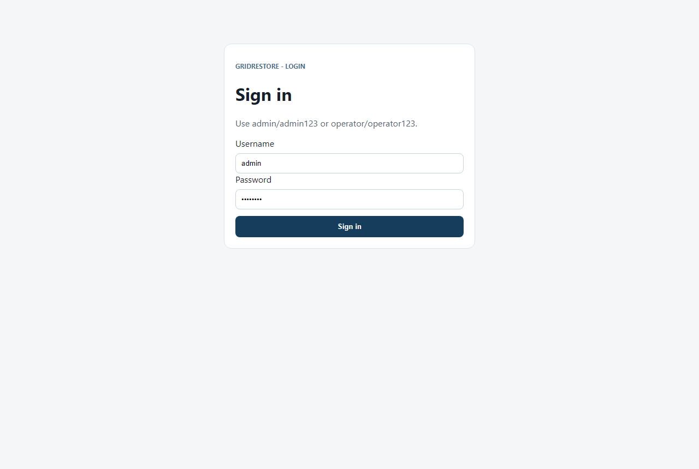
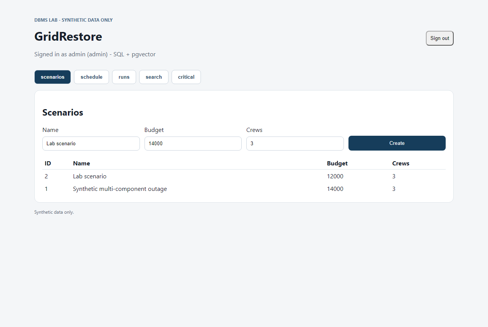
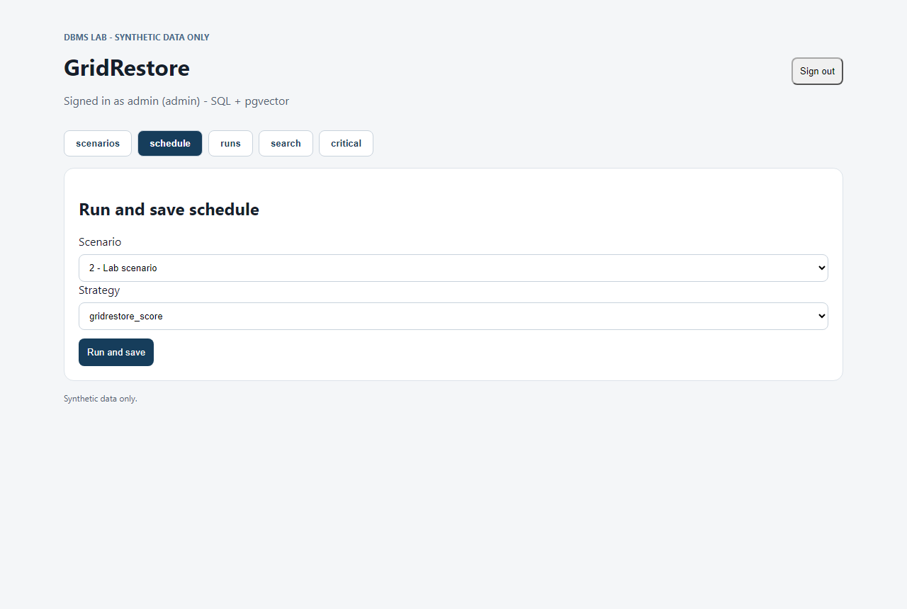
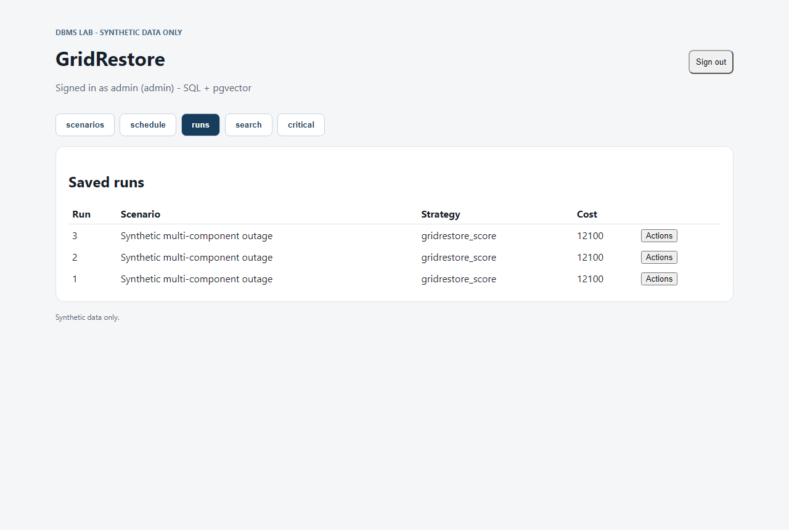
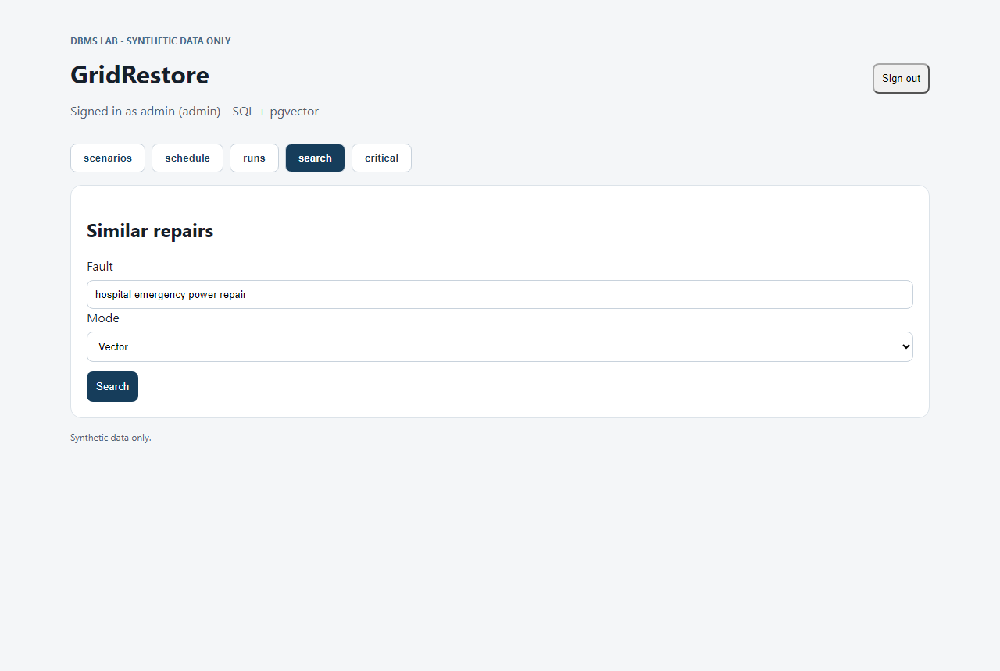

# Testing and validation (2026-10-18, local PostgreSQL 18.6 on port 5432)

Run from the project root:

```powershell
pip install -r requirements.txt
python -m pytest -q
```

## Result: 17 passed

Scheduler (8): budget bounds, action timing, dependency order, prereq finish→start,
multi-skill coverage, tight budget, cycle rejection, unknown strategy.
Vectors (3): embedding determinism + L2 norm, ranked cosine search, FTS hospital set.
Auth + API (6): wrong-password reject, operator-cannot-be-admin, login + 401 guard,
critical ranking, critical path chain/floor, critical endpoints as operator.

DB-dependent tests (vectors, auth, API, criticality) run against the configured
PostgreSQL via `DATABASE_URL`; pure scheduler/embedding tests need no database.

## PostgreSQL integration (verified)

1. Role/database created on local PostgreSQL 18, port 5432.
2. `.env` set: `DATABASE_URL` + `SESSION_SECRET`.
3. Applied `database/schema.sql`, `database/migrations/002_vectors.sql`, `003_auth.sql`.
4. `python -m backend.seed_demo` → scenario seeded; `python -m backend.vectors` → 8 embeddings.
5. Next.js (3000) + FastAPI (8000) verified: login, scenarios, schedule+save (run_id 3,
   cost 12100, 5 tasks), run actions, vector search (T02 0.42 top), critical chain T03→T05.
6. Query plans in `docs/PERFORMANCE.md` (Index Only / Bitmap Index / HNSW scans, no seq scans).

## Screenshots








## Notebook

`notebook/GridRestore_Lab.ipynb` executes start-to-finish via nbconvert with 0 error
cells (portable SQLite demo path).
